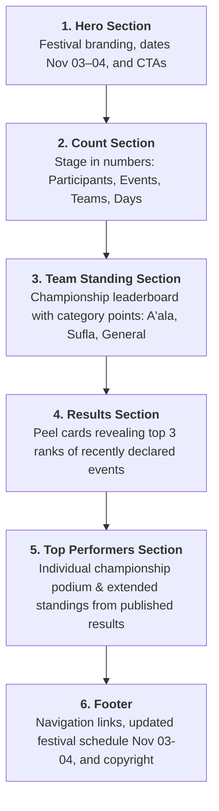

# Implementation Plan: Top Performers Section (EduFensta Home Page)

This technical specification details the complete plan and current implementation for the **Top Performers (Individual Championship)** section on the EduFensta Home Page (`EduFenstaHomePage.jsx`), powered strictly by **officially published competition results**. It also records the festival date update to **November 03–04, 2026**, the confirmed **page section hierarchy**, and the standardized **category sequence** (`A'ala`, `Sufla`, `General`).

---

## 1. Executive Summary & Section Hierarchy

### Confirmed Page Section Order
As requested, the EduFensta Home Page (`EduFenstaHomePage.jsx`) follows this strict visual progression:



---

## 2. Standardized Categories Specification

Across festival tables and reports, categories follow this precise scope:

### Team Standings Table Columns (Includes General)
Both the Home Page team standings table (`#ef-standings`) and the full team standings page (`/team-status`) display all three competitive categories:
1. **A'ala** (Chest prefix `201`)
2. **Sufla** (Chest prefix `101`)
3. **General** (Chest prefix `900`)

| Rank | Team | A'ala | Sufla | General | Total Points |
| :---: | :--- | :---: | :---: | :---: | :---: |
| **01** | Team Ruby | *pts* | *pts* | *pts* | **XXX PTS** |
| **02** | Team Emerald | *pts* | *pts* | *pts* | **XXX PTS** |
| **03** | Team Sapphire | *pts* | *pts* | *pts* | **XXX PTS** |

### Top Performers Categories (Excludes General)
- **Tabs Displayed**: Only **Overall**, **A'ala**, and **Sufla**. The **General** category is strictly omitted from Top Performers switcher tabs because participants belong to base categories (`A'ala` or `Sufla`), not `General`.
- **General Single Program Attribution**: When a participant participates in a General single program and scores points, those points are credited directly toward the participant's own base category total (e.g. an A'ala student's General program points appear under both **A'ala** and **Overall**).

---

## 3. Fest Date Update Summary

The festival schedule has been officially updated from October 06–07, 2026 to **November 03–04, 2026**.

| Component / File | Old Date | New Date | Status |
| :--- | :--- | :--- | :---: |
| `Backend/festalchemy` (`FestSettings.dates`) | `['2026-10-06', '2026-10-07']` | `['2026-11-03', '2026-11-04']` | **Active in DB** |
| [EduFenstaHomePage.jsx](file:///d:/codes/Final%20Project/Frontend/festalchemy/src/views/EduFenstaHomePage.jsx#L444) (Hero) | `06–07 OCTOBER 2026` | `03–04 NOVEMBER 2026` | **Updated** |
| [EduFenstaHomePage.jsx](file:///d:/codes/Final%20Project/Frontend/festalchemy/src/views/EduFenstaHomePage.jsx#L775-L776) (Footer) | `Day 1 — Oct 06 / Day 2 — Oct 07` | `Day 1 — Nov 03 / Day 2 — Nov 04` | **Updated** |
| [EduFenstaFooter.jsx](file:///d:/codes/Final%20Project/Frontend/festalchemy/src/components/EduFenstaFooter.jsx#L52-L53) (Footer) | `Day 1 — Oct 06 / Day 2 — Oct 07` | `Day 1 — Nov 03 / Day 2 — Nov 04` | **Updated** |
| [HomePage.jsx](file:///d:/codes/Final%20Project/Frontend/festalchemy/src/views/HomePage.jsx#L610-L611) (Legacy Home) | `Day 1 — Oct 06 / Day 2 — Oct 07` | `Day 1 — Nov 03 / Day 2 — Nov 04` | **Updated** |

---

## 4. Scoring Rules & Eligibility Specification

### A. Individual Performer Eligibility
- **Single Events Only**: Points awarded in `program.type == 'single'` contribute to the individual student tally. Group programs (`program.type == 'group'`) award points to the team, not individual members.
- **Published Status**: Only results where `Result.published == True` are eligible. Draft or unverified marksheets are never leaked.

### B. Point Composition
Each published single event result contributes:
$$\text{Performer Event Points} = \text{Base Grade Points} + \text{Prize Bonus Points}$$

```mermaid
flowchart TD
    R[Published Result in Single Event] --> G{Grade Achieved?}
    G -->|A+ (>=90%)| B5[+5 Grade Points]
    G -->|A (70-89%)| B3[+3 Grade Points]
    G -->|B (60-69%)| B2[+2 Grade Points]
    G -->|C (50-59%)| B1[+1 Grade Point]
    G -->|< 50% / None| B0[0 Grade Points]
    
    R --> P{Rank / Prize?}
    P -->|Rank 1| P5[+5 Prize Bonus]
    P -->|Rank 2| P3[+3 Prize Bonus]
    P -->|Rank 3| P1[+1 Prize Bonus]
    P -->|Rank 4+| P0[+0 Bonus]
    
    B5 & B3 & B2 & B1 & B0 --> SUM[Sum = Event Total Points]
    P5 & P3 & P1 & P0 --> SUM
    SUM --> IND[Aggregated to Member Total Points]
```

### C. Dense Tie-Ranking Standard
As per official festival championship guidelines:
- **Equal Points Share Equal Ranks**: If two participants (or teams) have the exact same point total (e.g., both have 50 points), both receive **50 points** and both are assigned **Rank 1 ("two firsts")**.
- **Co-Champions / Dual Podiums**: Both Rank 1 performers receive the Gold Champion badge (`CHAMPION #01`), the pulsing Gold Crown, Gold avatar, and Gold glow.
- **Dense Progression**: The participant with the next highest points receives **Rank 2** (e.g. 50 pts $\to$ Rank 1, 50 pts $\to$ Rank 1, 40 pts $\to$ Rank 2).
- **Extended Roster**: If participants in the extended standings share points, both display their identical dense rank (e.g. `#{p.rank}`).

---

## 5. Backend API Contract (`/api/public/stats/`)

The public endpoint `PublicDashboardStatsAPIView` in [api_views.py](file:///d:/codes/Final%20Project/Backend/festalchemy/festalchemy/api_views.py#L1540):
1. Returns `categories` ordered as `["A'ala", "Sufla", "General"]`.
2. Includes `member__chest_no` in individual aggregations.
3. Exposes `top_performers` (overall top performers across all single events).
4. Orders `individual_leaderboard` categories strictly by `["A'ala", "Sufla", "General"]`.

### JSON Response Schema
```json
{
  "fest_settings": { ... },
  "stats": { ... },
  "categories": [
    { "id": 34, "name": "A'ala", "chest_prefix": 201 },
    { "id": 35, "name": "Sufla", "chest_prefix": 101 },
    { "id": 33, "name": "General", "chest_prefix": 900 }
  ],
  "leaderboard": [ ... ],
  "top_performers": [
    {
      "member_id": 42,
      "member_name": "Aadil Rahman",
      "member__chest_no": 205,
      "member__team__name": "Team Ruby",
      "member__category__name": "A'ala",
      "total_points": 26,
      "events_count": 3
    }
  ],
  "individual_leaderboard": [
    {
      "category_id": 34,
      "category_name": "A'ala",
      "performers": [ ... ]
    },
    {
      "category_id": 35,
      "category_name": "Sufla",
      "performers": [ ... ]
    },
    {
      "category_id": 33,
      "category_name": "General",
      "performers": [ ... ]
    }
  ],
  "recent_results": [ ... ]
}
```

---

## 6. UI/UX Design Specification for Top Performers Section

### Layout & Component Anatomy

```
+-----------------------------------------------------------------------------------+
|  [ EYEBROW: HALL OF FAME ]                                                        |
|  TOP PERFORMERS                                                                   |
|  Individual excellence calculated live from officially declared single results   |
|                                                                                   |
|  [ [⭐ Overall Champions]   [ A'ala ]   [ Sufla ] ]                                |
|                                                                                   |
|                   +-------------------+                                           |
|                   |      #1 GOLD      |                                           |
|  +------------+   |   👑 CROWN ICON   |   +------------+                          |
|  |  #2 SILVER |   |   Aadil Rahman    |   |  #3 BRONZE |                          |
|  | Salman F.  |   |   #205 · Team Ruby|   | Nihal P.   |                          |
|  | 18 PTS     |   |      26 PTS       |   | 15 PTS     |                          |
|  +------------+   +-------------------+   +------------+                          |
|                        (ELEVATED)                                                 |
|                                                                                   |
|  +-----------------------------------------------------------------------------+  |
|  | #04  Zayan Ahmed      #212  · Team Sapphire  · A'ala       | 14 PTS | 2 Events|  |
|  | #05  Aysha Rima       #108  · Team Diamond   · Sufla       | 12 PTS | 2 Events|  |
|  | #06  Bilal Farooq     #215  · Team Emerald   · A'ala       | 11 PTS | 1 Event |  |
|  +-----------------------------------------------------------------------------+  |
+-----------------------------------------------------------------------------------+
```

### Visual Highlights
1. **Interactive View Switcher (Pills)**:
   - `[⭐ Overall Champions]` (Festival-wide leaders)
   - Dynamic Category Pills: `[ A'ala ]`, `[ Sufla ]` (strictly student categories, excludes General)
2. **Olympic-Style Podium (Top 3)**:
   - **Rank 1 (Gold)**: Centered or side-by-side for ties, elevated (`transform: translateY(-16px)` on desktop), glowing crown icon with pulse animation, gold gradient avatar, large point counter.
   - **Rank 2 (Silver)**: Silver medal badge, silver gradient avatar.
   - **Rank 3 (Bronze)**: Bronze medal badge, bronze gradient avatar.
3. **Runners-Up Grid (Positions 4, 5, 6)**:
   - Limited strictly to the first 6 positions total (top 3 on podium + ranks 4 to 6 in extended standings).
   - Clean neo-editorial cards displaying dense rank number, participant name, chest number badge (`#205`), team name, category badge, and animated points.
4. **No Standings CTA**:
   - The Top Performers section ends cleanly after the first 6 positions without a redundant standings redirect button.
5. **Zero-State Placeholder**:
   - Clean dark container with crimson trophy icon and reassuring status message when no single results have been published yet.

---

## 7. Verification & Status Summary

| Item | Expected | Verification Result |
| :--- | :--- | :---: |
| **Section Sequence** | Hero → Count → Team standing → Results → Top Performers → Footer | **Verified in EduFenstaHomePage.jsx** |
| **Category Sequence** | A'ala, Sufla, General | **Verified in DB & Frontend** |
| **Team Standings Columns** | #, Team, A'ala, Sufla, General, Total | **Verified in Home & Team Status** |
| **Fest Dates** | 03–04 November 2026 | **Verified across all files** |
| **Build Status** | `npm run build` | **`Built in 5.97s` (0 errors)** |
| **Backend API** | `http://127.0.0.1:8000/api/public/stats/` | **HTTP 200 OK** |
| **Frontend Dev Server** | `http://localhost:5173/` | **HTTP 200 OK** |
